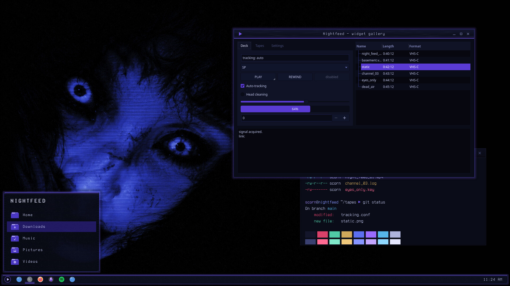
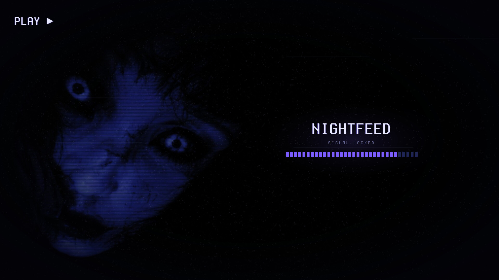
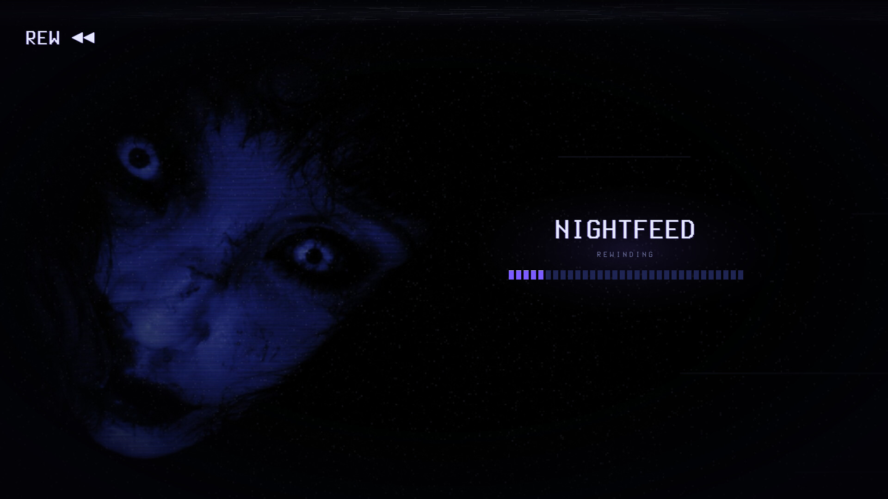

# Nightfeed — Global Theme (Plasma 6)

The Nightfeed global theme: switches Plasma to the whole suite at once, and ships the VHS rewind/play splash screen.



Nightfeed is a night-vision VHS look for KDE Plasma 6, built around a cobalt-lit face on near-black: cobalt-black surfaces, faint scanlines and tape grain, and a slight violet glow on whatever has focus.

## Features

- **Splash screen:** the tape rewinds (`REW ◀◀`, fast tracking band) and then plays (`PLAY ▶`). Tape blocks fill as Plasma's six startup stages arrive.
- **Defaults:** colour scheme, Plasma style, icons, Kvantum widget style, Aurorae window decoration and splash, all set to Nightfeed.
- **Ships no panel layout,** so applying it never rearranges your panels or widgets.




## Requirements

Plasma 6. Install the other Nightfeed pieces first (colour scheme, Plasma style, Aurorae, icons, Kvantum), or the global theme falls back to Breeze for whatever is missing. Kvantum needs `kvantum` installed.

## Install

```bash
git clone https://github.com/numbpill3d/nightfeed-global
cd nightfeed-global && ./install.sh
```

Or from the KDE Store: System Settings → Colors & Themes → Global Theme → Install from File, or extract to `~/.local/share/plasma/look-and-feel/`. The splash alone can be picked under Colors & Themes → Splash Screen.

## The rest of the suite

| piece | repo |
|---|---|
| SDDM login | [nightfeed-sddm](https://github.com/numbpill3d/nightfeed-sddm) |
| Plymouth boot splash | [nightfeed-plymouth](https://github.com/numbpill3d/nightfeed-plymouth) |
| Plasma style (panel, popups) | [nightfeed-plasma](https://github.com/numbpill3d/nightfeed-plasma) |
| Aurorae window decoration | [nightfeed-aurorae](https://github.com/numbpill3d/nightfeed-aurorae) |
| Colour scheme | [nightfeed-colors](https://github.com/numbpill3d/nightfeed-colors) |
| Kvantum widget style | [nightfeed-kvantum](https://github.com/numbpill3d/nightfeed-kvantum) |
| Icon theme | [nightfeed-icons](https://github.com/numbpill3d/nightfeed-icons) |
| Konsole + kitty colours | [nightfeed-konsole](https://github.com/numbpill3d/nightfeed-konsole) |

Everything at once, with the generators: [nightfeed](https://github.com/numbpill3d/nightfeed).

## Tags

`nightfeed` `kde` `plasma6` `dark` `vhs` `scanlines` `cobalt` `violet` `purple` `retro` `analog-horror` `glow` `global-theme` `look-and-feel` `splash-screen` `ksplash` `plasma-6`

## Credits and licence

By splicer scorn (voidrane). GPL-3.0-or-later.
OSD font: Terminess Nerd Font (Terminus, SIL OFL 1.1), bundled with its licence.
